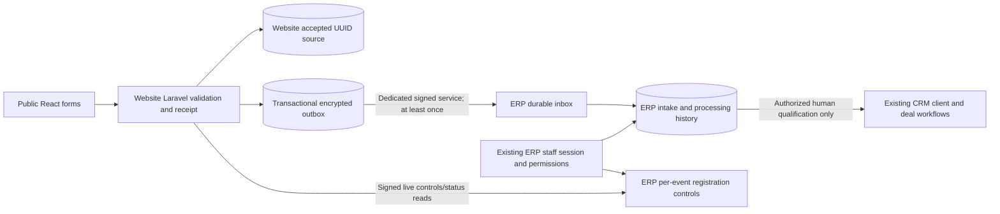

# Phase 4 — Registrations, CRM Intake, Buyer Relations and Visitor Management

Review date: 2026-11-04 (Africa/Cairo). Status: implementation and isolated verification; draft-only release. Findings labelled **Verified** refer to repository inspection or the isolated tests below. **Requires staging verification** means no production claim is made.

## Dependency chain and scope

- ERP Phase 4 branch `codex/phase-4-registrations` starts at verified Phase 3 `5e904496db219a467a8ec6eec92883aea174aa0b`, targets `codex/phase-3-cms-integration` (PR #3), dependent on Phase 2 PR #2 and Phase 1 PR #1.
- Website Phase 4 branch `codex/phase-4-public-intake` starts at verified Phase 3 `bf649ff691e476b27d1b08dcd43ee6e18b97868e`, targets `codex/phase-3-cms-gateway` (PR #2), itself targeting main.
- Both Phase 3 PRs were open, draft and unmerged when work began. Their gateway, sessions, CMS media, commercial tables and original business services remain separate.
- No merge, deployment, operational migration/import, production form activation, dependency upgrade, checkout or Phase 5 implementation was performed.

## 1. Verified original form and business mapping

| Source | Original behavior | Phase 4 behavior |
|---|---|---|
| `src/pages/PremiumContact.tsx` | Direct generic CMS resource submission; speaker option mismatched backend | Existing hero/contact/map retained; typed intake, bilingual receipt and withdrawal |
| `src/pages/PremiumVisitors.tsx` | General-contact CTA and obsolete hardcoded dates/counts | Independent visitor registration; authoritative approved dates and closed state |
| `src/pages/PremiumExhibitors.tsx` | Contact CTA | Contact prefilled as exhibitor; qualified conversion uses existing ERP client service |
| `src/pages/PremiumSponsors.tsx` | Contact CTA and marketing package prices | Contact prefilled as sponsor; no price copied into financial fields |
| Website `contact_submissions` | UUID legacy source records | Preserved; separately authorized reconciliation to historical enquiries |
| Website `visitor_registrations` | UUID interest records | Preserved as `visitor_interest`, never confirmed visitors |
| ERP `clients`, `deals` | Integer clients and existing pipeline | Existing commercial types/stages/services reused after explicit qualification |
| ERP tasks/notifications | Existing task module requires unrelated client/user capabilities | Generic existing notifications reused; intake-specific protected correspondence/follow-up records avoid granting Finance or client management |

The installed applications remain React/Laravel 12/MySQL ERP and React/Laravel 13/MySQL website. No application was rebuilt.

## 2. Architecture and authoritative ownership

**Verified:** website owns accepted source data and original UUID/time; ERP owns processing status, assignment, event controls, reviewed organization identity and client linkage. Browser never writes to both databases. No cross-database FK, shared application key, employee cookie or CMS writer credential is introduced. Contract version 1 is committed identically as `backend/config/intake-contract.json` in both repositories.

The first deployed binding is one explicit `green-life-expo` site and `INTAKE_EXHIBITION_ID`. Every record and signed claim contains that binding. Tables support multiple exhibitions; another public exhibition requires a separately reviewed site/service binding and routing configuration. Arbitrary browser-supplied event switching is intentionally unsupported.

## 3. Schema and identity mapping

| Database/table | Key and relationships | Owner/purpose |
|---|---|---|
| Website `public_submissions` | UUID PK, unique UUID idempotency key, integer ERP event ID without cross-DB FK | Immutable accepted encrypted source, consent, hash-only 90-day receipt, withdrawal |
| Website `submission_outbox` | UUID message PK; source UUID FK; unique source/event | Immutable encrypted signed-envelope source, retry/lease/ack state |
| Website `submission_delivery_audits` | Integer PK, UUID message pointer | Authorized replay history without applicant details |
| Both `intake_nonces` | SHA-256 nonce identity, expiry index | Separate service replay prevention |
| ERP `intake_submissions` | Integer PK; unique site/source UUID; integer exhibition, assignee, client, organization and duplicate FKs | Normalized restricted search fields, encrypted original payload, versioned processing |
| ERP `intake_inbox` | UUID message PK, payload hash, integer intake FK | Durable exactly-once processing effects for retries |
| ERP `buyer_organizations` | Integer PK; created by existing staff | Human-reviewed identity shared by participation/application records |
| ERP `intake_history` | Integer PK, intake FK, actor FK, encrypted reason | Append-only processing history |
| ERP `intake_activities` | Integer PK, intake FK, encrypted note, UTC due/completion | Authorized correspondence and follow-ups |
| ERP `registration_controls` | Unique site/event/type; version | Independent exhibitor/sponsor/buyer/visitor/general availability, approved dates, notices |
| ERP `intake_control_audits` | Integer PK and actor/event | Configuration and export-count audit |

No existing users, migration histories, sessions, jobs, financial tables or business records are combined. Both additive migrations are `2026_11_04_000001_*`. Existing applications ignore the additional tables, making schema-first installation compatible with the Phase 3 code.

Normalized ERP email/phone/company fields remain plaintext for authorized search; original values, sourcing details, consent and history reasons/notes use each application's own encryption key. **Requires staging verification:** DB volume/backups encryption, least-privilege DB users, key escrow and restore exercises. Application encryption does not replace infrastructure encryption.

## 4. API contract and reliability

Public website endpoints under the existing same-origin web/CSRF stack:

- `GET /api/registrations/controls`: safe event configuration, no-store, closed on unavailable ERP.
- `POST /api/registrations/submit`: UUID idempotency key, type, bounded validated payload, honeypot and form age; atomic source plus outbox.
- `POST /api/registrations/status` and `/withdraw`: source UUID plus confidential receipt token in request body; no personal details returned.

Dedicated backend-only POST endpoints `/api/internal/intake/{accept,controls,status}` on ERP, and `{monitor,replay,manifest}` on website. Authentication signs exact request bytes and URI/method plus version, purpose, issuer, audience, site, event, key ID, issued/expiry time and random nonce. Lifetime <=30 seconds; replay nonce uniqueness is durable. Credentials are backend-only `INTAKE_SERVICE_KEY`, separate from CMS and APP_KEY. HTTPS, TLS verification, fixed configured origin, no redirect following, 64 KiB request and 256 KiB response bounds. HTTP loopback is allowed only in local/testing environments.

ERP authenticated endpoints live under `/api/intake`: list/detail/staff assignment, versioned processing actions, organizations, CSV export, controls, delivery monitoring, replay and reconciliation. Each action checks its permission, event membership and record scope server-side. Signed routes are stateless and cannot call CMS administration or commercial mutations.

Worker `php artisan intake:deliver --limit=50` claims rows using MySQL `FOR UPDATE SKIP LOCKED`, a random lease and a 60-second expiry. Network I/O occurs after the claim transaction. It sends the same immutable message UUID, validates matching durable ERP acknowledgement, and updates only its own lease. Interrupted workers can be reclaimed. Backoff is bounded exponential, capped at one hour; ten failures enter failed state. Authorized replay preserves UUID and payload and refuses an active lease. `intake:prune-nonces` removes only expired replay tokens, bounded to 5,000.

ERP acceptance serializes first source acceptance on the linked exhibition row. Inbox message hashes reject altered replays; site/source UUID uniqueness prevents duplicate effects across different message IDs. Original form/type/source system/historical flag/time/hash are immutable. A withdrawal arriving before its source is retried; later original-message replay cannot undo withdrawal. This intentionally favors integrity over maximum per-event ingestion throughput; load testing is a release prerequisite.

Public submissions require live controls on first acceptance. If ERP is already unavailable, new submissions fail closed and invite retry. Once accepted, a subsequent ERP outage cannot lose the source/outbox. No email delivery is claimed or configured. A lost initial response is safely replayable but cannot reveal the hash-only receipt token again; organizer-assisted identity verification is required if the applicant did not save it.

## 5. Human workflows

### Sales and general enquiries

Received -> triage/assignment -> contacted -> qualified/disqualified/duplicate/withdrawn. Qualification plus an explicit distinct matching review is required before client conversion. Authorized employees can link an existing visible compatible client or create a prospect through the unchanged `CrmService`. Sponsor and sector sponsor types remain distinct. Opportunity creation remains the existing Deals workflow after conversion. No acceptance/conversion automatically creates deals, booths, agreements, invoices, installments, receipts or commissions. General/speaker/media/partnership/other/visitor-interest appear in central triage, with dedicated tabs for exhibitor/sponsor leads and overdue follow-ups.

### Buyer Relations

Submitted -> under review -> more information required / verified / rejected / withdrawn. Reviewed organizations must be linked before verification; `buyers.approve` is distinct from `buyers.review`. The same organization can have multiple people/event applications without public records overwriting its identity. Organization linking requires current visibility through an authorized participation. Applications, verified buyers, organizations and overdue follow-ups use native ERP tables/cards/dialogs. Verification grants no Hosted Buyer, travel, visa, delegation or matchmaking entitlement.

### Visitor Management

Submitted -> human-confirmed/cancelled/duplicate/withdrawn; reopening has explicit allowed transitions. Duplicate status requires a manually linked match. Approved visitor dates must lie within the existing exhibition interval. Counts mean registrations, never attendance. Receipt withdrawal records a terminal public cancellation and delivers it durably to ERP. No QR/access-control credential or admission promise is introduced.

## 6. Permissions, privacy and security

- Existing staff session/MFA/reset/revocation architecture retained. No second employee login.
- New explicit permissions: `submissions.{view,assign,manage,activity,export,review_duplicates}`, `buyers.{view,assign,review,approve,activity,export,review_duplicates}`, `visitors.{view,assign,manage,activity,export,review_duplicates}`, `leads.{qualify,convert}`, `registrations.{configure,deliveries,replay}`.
- New permissions default to Super Admin only and remain disabled when the intake flag is off. Existing module grants do not silently confer these actions. Each action depends on its family view permission; replay depends on delivery permission.
- Event membership and existing all/team/own scope are applied to lists, details, matches, activities, organizations and exports. Assignment targets must be active and permitted for module/event. Notifications carry generic text and fresh pointer authorization.
- Public body limits, strict allowlists, UUID/hash conflict checks, CSRF, IP/email throttles, form timing and honeypot are enforced server-side. These are baseline anti-automation controls; edge/WAF tuning under real load remains necessary.
- English/Arabic notices require explicit policy version and both approved texts before opening. Operational processing consent is required; marketing consent is optional and separately stored with server timestamp. International free-text countries and country codes are accepted; original Unicode text and phone values survive alongside conservative normalization.
- No document-upload endpoint is added. Optional buyer supporting information is bounded text with a warning against sensitive documents. Existing private-file authorization is untouched.
- Public CMS resources never expose applications. During enabled cutover, old generic legacy submission write endpoints return 409, avoiding an unmonitored parallel writer. With the feature off the Phase 3 legacy backend remains compatible; deploy sequencing must close old public writers before activation.
- CSV export requires family export action plus event/record scope, max 5,000 rows, Unicode BOM and formula neutralization. No-store headers protect intake response caching. Do not configure proxy/browser analytics to collect request bodies or receipt secrets.

### Retention and data-subject procedure

`php artisan intake:retention-report` is read-only, refuses an unset/unapproved `INTAKE_RETENTION_DAYS`, and returns aggregate candidate counts only. No automatic purge runs. The retention period must be approved for the actual processing purpose/jurisdiction before release; this report makes no legal-policy assumption.

For a verified deletion/correction request: validate receipt or identity through a permitted staff process; identify source UUID and all linked ERP processing/organization records; suspend contact and record withdrawal if appropriate; assess legal holds and financial record obligations; reconcile pending outbox/inbox and back up; prepare separately reviewed, reversible redaction for source, encrypted envelopes, normalized contacts, free-text notes and relevant organization data across both systems. Preserve non-PII UUID/hash audit evidence and legally required commercial records. Review shared organizations/other people before redaction. Document retention in backup expiry and prevent replay from restoring erased PII. Obtain explicit authorization before implementing or executing the redaction operation. This phase supplies the report and procedure, not an unapproved destructive erasure command.

## 7. Historical reconciliation

Website command `intake:reconcile-history contact_submissions --exhibition=<reviewed-id> --limit=100` (or `visitor_registrations`) defaults to dry-run; `--after=<UUID>` resumes a bounded, sorted UUID batch. `--apply` is a separate operational authorization boundary. It preserves original UUID/time and encrypted `legacy_original` snapshot, records unknown consent as false, distinguishes visitor interest, rejects invalid/conflicting/oversized sources and atomically creates source/outbox only for new identities. Counts, cursor and checksum contain no applicant details. Repeated apply skips identical rows. Synthetic tests cover dry-run, apply and restart; no operational historical import was run. Dry-run output and event binding must be reviewed before each production import batch.

## 8. Safe release sequence and rollback

1. Merge dependency chain only after separate approval. Back up both DBs and private/public assets, verify deployed schema/data/bindings and restore in staging. Check actual infrastructure, DNS/TLS, clocks and secret management.
2. Keep `INTAKE_ENABLED=false` in both apps. Install ERP and website additive schemas independently. Previous Phase 3 binaries remain compatible; never run fresh/reset/seed on operational DBs.
3. Deploy ERP receiver/permissions/UI and website outbox/controllers/UI code with intake disabled. Cache configuration deliberately; use distinct APP_KEY/session cookies and a fresh dedicated service key. Grant reviewed action/event/record permissions with the existing revocation process.
4. In staging, verify complete suite, browser workflows, failover, concurrent delivery/lease recovery, rate limits, private logs, exported CSV, backups, monitoring and load. Review approved event dates, bilingual notices and content figures. Synthetic dates used in tests are not event announcements.
5. Prepare controls while no public writes are possible. Enable ERP receiver and verify signed controls/monitoring; enable website integration only after ERP/control readiness and old writer handling are confirmed. Closed controls remain authoritative. Start a supervised bounded outbox worker separately; example every minute with overlap prevention, plus expiry-only nonce maintenance. No worker/scheduler was activated operationally during implementation.
6. Open each approved form type independently. Watch queue oldest-age/failure counts and reconcile source UUID pages. Import historical data only after separate authorization. Run a synthetic canary in staging before cutover approval.

Rollback: close forms first, stop new public acceptance, preserve all accepted source/outbox/inbox records, drain or pause delivery consciously, disable feature flags and revert binaries in reverse order. Keep additive tables and encryption keys; **do not run migration down after real submissions exist**, because down drops new tables. A pre-acceptance empty-schema rollback is structurally reversible, but populated data rollback requires reviewed backup/export retention. Never replay with changed source identities. Do not roll back to an old uncontrolled public form writer while accepted Phase 4 data is pending.

## 9. Verification results and browser evidence

Local execution uses only `space_crm_test` / `green_life_expo_test` for destructive test suites, guarded before RefreshDatabase. UI uses separate `space_crm_phase4_ui_test` / `green_life_expo_phase4_ui_test` cloned exclusively from named synthetic Phase 3 fixtures. No operational source records were copied. Per-repository suites run sequentially against their own disposable database.

- ERP complete regression before final hardening: **151 tests, 2,202 assertions passed**. After source-provenance hardening: targeted **11 tests, 85 assertions passed**. Final full-suite result recorded below.
- Website final full Laravel suite: **45 tests, 312 assertions passed**.
- ERP frontend: **20/20 passed**; TypeScript passed; all **32** sidebar destinations verified; production build passed.
- Website frontend: **9/9 passed**; TypeScript passed; production build passed. Existing chunk-size/Browserslist warnings remain; no dependency changes.
- Tests cover typed routing, bilingual/international payloads, source UUID/hash preservation, encryption, no automatic commercial effects, event/own scope, assignment and approval restrictions, controlled conversion, CSV escaping, signed service replay, transactional outbox, outage/replay/lease behavior, approved controls and historical reconciliation. Existing Phase 1–3 auth/MFA/reset/session/attachments/financial/booth tests remain part of full regressions.

Browser verification uses actual React pages and Laravel/MySQL services, no separate website-admin login. Recorded so far: international buyer application with Japanese and Arabic text -> receipt -> dedicated service -> ERP -> human organization review -> verified status; Arabic visitor -> accepted source -> ERP; Arabic withdrawal -> terminal public status -> outbox -> ERP; exhibitor contact -> sales intake. Remaining browser and final CI results are appended after completion, not assumed.

Operational preservation: the read-only fingerprint comparison still matches the Phase 3 saved baseline: ERP **37 tables/3 private files**, website **19 tables/2 assets**. These fingerprints cover existing operational business/content records and designated private/public asset trees, not synthetic test DBs or transient service processes. No operational migration/reset/seed/import occurred.

Visual evidence is captured under local `outputs/phase4-visual`. Baseline filenames were labelled desktop/mobile, but the browser's initial capture surface did not reliably follow the requested viewport dimensions; the report records actual capture limitations rather than claiming pixel-identical full-viewport comparisons. Existing ERP business pages and shared design/CSS are byte-equivalent to Phase 3, independently tested. Public shared header/footer/styles/tokens are byte-equivalent; only requested form journeys, CTAs and neutral corrections to unapproved counts/dates change. New pages reuse each application's existing primitives and typography.

## 10. CI, PRs and release prerequisites

Both workflows use isolated per-job MySQL 8.4 services, synthetic public CI credentials, no repository operational secrets, pinned actions, sequential Laravel suites and no deployment step. Branch filters include the Phase 4 branch and Phase 3 PR base. Jobs cannot share a MySQL instance. Final PR URLs, heads, GitHub Actions URLs/counts and final browser evidence are recorded below after publication.

**Requires staging/production verification:** actual deployed schema and data, approved notices/policy/retention, correct event/date/public content, verified service endpoints and clock sync, MySQL 8 SKIP LOCKED support, proxy Content-Length/no-store/rate-limit behavior, TLS and secret rotation, logs/APM redaction, worker supervision/alerts, representative load and backup restore. Mail remains disabled until separately verified; no email can be represented as sent.

**Phase 5 readiness:** source UUIDs, per-event participations, reviewed organization identity, human verification and granular permissions form an extensible boundary. Phase 5 must remain a separately authorized dependent branch after Phase 4 review; no matchmaking, Hosted Buyer acceptance, travel sponsorship or access-control engine exists here.

## 11. Exact changed-file inventory

Paths below are repository-relative. No dependencies, operational env files, private files or existing financial/booth services are included.

### ERP

- `.github/workflows/erp-tests.yml`
- `backend/.env.example`
- `backend/app/Console/Commands/ReportIntakeRetention.php`
- `backend/app/Http/Controllers/IntakeController.php`
- `backend/app/Http/Controllers/IntakeReceiverController.php`
- `backend/app/Http/Middleware/AuthenticateIntake.php`
- `backend/app/Http/Middleware/LimitIntakeRequest.php`
- `backend/app/Services/AuthorizedData.php`
- `backend/app/Services/IntakeAccess.php`
- `backend/app/Services/IntakePayload.php`
- `backend/app/Services/IntakeTransport.php`
- `backend/app/Services/PermissionPolicy.php`
- `backend/app/Services/PermissionRegistry.php`
- `backend/bootstrap/app.php`
- `backend/config/authorization.php`
- `backend/config/intake-contract.json`
- `backend/config/intake.php`
- `backend/database/migrations/2026_11_04_000001_create_registration_intake.php`
- `backend/routes/console.php`
- `backend/routes/intake.php`
- `backend/routes/web.php`
- `backend/tests/Feature/RegistrationIntakeTest.php`
- `docs/PHASE-4-REGISTRATIONS-INTEGRATION.md`
- `scripts/registration-ui.test.mjs`
- `scripts/verify-navigation.mjs`
- `src/App.tsx`
- `src/auth/access.ts`
- `src/components/layout/Sidebar.tsx`
- `src/contexts/AuthContext.tsx`
- `src/pages/RegistrationControls.tsx`
- `src/pages/RegistrationWorkspace.tsx`

### Website

- `.github/workflows/ci.yml`
- `backend/.env.example`
- `backend/app/Console/Commands/ReconcileHistoricalSubmissions.php`
- `backend/app/Console/Commands/ReportIntakeRetention.php`
- `backend/app/Http/Controllers/IntakeDeliveryController.php`
- `backend/app/Http/Controllers/PublicRegistrationController.php`
- `backend/app/Http/Controllers/ResourceController.php`
- `backend/app/Http/Middleware/AuthenticateIntake.php`
- `backend/app/Http/Middleware/LimitIntakeRequest.php`
- `backend/app/Services/IntakePayload.php`
- `backend/app/Services/IntakeTransport.php`
- `backend/app/Services/SubmissionOutbox.php`
- `backend/bootstrap/app.php`
- `backend/config/cms.php`
- `backend/config/intake-contract.json`
- `backend/config/intake.php`
- `backend/database/migrations/2026_11_04_000001_create_public_intake.php`
- `backend/routes/cms.php`
- `backend/routes/console.php`
- `backend/routes/web.php`
- `backend/tests/Feature/PublicRegistrationTest.php`
- `docs/PHASE-4-REGISTRATIONS-INTEGRATION.md`
- `scripts/registration-ui.test.mjs`
- `src/App.tsx`
- `src/components/RegistrationForm.tsx`
- `src/pages/PremiumContact.tsx`
- `src/pages/PremiumExhibitors.tsx`
- `src/pages/PremiumIndex.tsx`
- `src/pages/PremiumRegistration.tsx`
- `src/pages/PremiumSponsors.tsx`
- `src/pages/PremiumVisitors.tsx`

## 12. Final local verification addendum

**Verified (2026-11-04):** final ERP full regression **152 tests / 2,207 assertions**, all passed. Website **45 / 312**, all passed. ERP frontend **20/20**, website frontend **9/9**, both TypeScript checks and production builds passed; navigation **32/32**.

Browser sales cycle completed: source `92780a74-6bb4-4859-bb23-5ce6e9365024` -> intake #4 -> contacted -> qualified -> explicit distinct matching review -> existing client service -> synthetic prospect #2. No deal/booth/payment/commission action was invoked. Buyer source `af5ace7d-9522-4908-9fc1-e23f4c630ada` -> organization reviewed -> verified. Visitor withdrawal source `3df67718-3192-4881-84bc-de3ee64a3457` -> withdrawn -> durable delivery.

Additional real HTTP submissions: sponsor `270a63a3-d388-4144-955d-70cfb95f99b2` and speaker `059fc2c1-b745-467e-bd30-b7f6f9714980`; identical retries returned the same UUID, changed payload retries returned 409. Deliberately stopped only the isolated ERP receiver: worker returned delivered=0/failed=2; accepted source/outbox rows remained. ERP browser reconciliation reported source=6/accepted=4/missing=2. Restarted receiver, invoked authorized Replay from the ERP UI with original message UUIDs, and worker delivered both without duplicate processing. Runtime fixture launch initially used an artisan environment selector that rejected HTTP loopback; corrected only the isolated launcher, preserving the production HTTPS restriction.

Restricted synthetic buyer employee actual HTTP session checks: buyer #1 and exhibitor #4 detail 404 (unassigned own scope); Finance 403; registration controls 403; deliveries 403; export 403; crafted verification action 404. Laravel tests separately prove event membership, assigned own-scope access and approval denial.

For deployment, use a persistent shared cache store for rate limiting (never the isolated fixture's array store). Validate rate limits and CSRF with production-mode middleware in staging. The local browser's development-server dependency optimization became unstable during builds; final UI verification uses built production assets with loopback API proxies instead.
